# โจทย์ที่ 2 ระบบตรวจสอบย้อนกลับสินค้าเกษตรปลอดภัย

**AgriSupplyTracker** ติดตามล็อตสินค้าเกษตรจากฟาร์มถึงร้านค้าบน Ethereum Sepolia ผู้บริโภคใช้ Batch ID เพื่อดูแหล่งผลิต เวลาเก็บเกี่ยว ใบรับรอง ผู้ครอบครองปัจจุบัน สถานะการเรียกคืน และประวัติการส่งมอบได้โดยไม่ต้องเชื่อมกระเป๋า

หน้าเว็บพัฒนาด้วย React, Vite และ TypeScript ใช้ viem อ่านข้อมูลผ่าน Sepolia RPC และใช้ MetaMask ยืนยันธุรกรรมกับ [สัญญา AgriSupplyTracker](contracts/AgriSupplyTracker.sol)

## เว็บและสมาร์ตคอนแทรกต์

- [เปิดเว็บ AgriSupplyTracker](https://jnatchaya.github.io/AgriSupplyTracker/) แล้วค้นหา Batch ID `GF-TEST-001` เพื่อดูล็อตที่ใช้ทดสอบ
- ที่อยู่สมาร์ตคอนแทรกต์บน Ethereum Sepolia คือ `0x9F3eBe591965EF89C4Fd4C8C752792F35Ac71ce9` [ดูคอนแทรกต์บน Sepolia Etherscan](https://sepolia.etherscan.io/address/0x9F3eBe591965EF89C4Fd4C8C752792F35Ac71ce9)

## สมาชิกกลุ่ม

| รหัสนักศึกษา | ชื่อ–นามสกุล |
|---|---|
| 66044011 | นายทัตซึโนริ คาโต้ |
| 66066266 | นางสาวเบญจวรรณ พูลทรัพย์ |
| 66050217 | นางสาวกัลยรัตน์ ถิ่นหาญวงศ์ |
| 66023796 | นางสาวณัฐชยา ตั้งมั่น |

## บทบาทผู้ใช้งาน (Roles)

| บทบาท | หน้าที่ | บัญชีในการทดสอบ |
|---|---|---|
| ผู้จัดการ (Manager) | กำหนด เปลี่ยน หรือถอนบทบาทของบัญชีอื่น ยกเลิกคำขอส่งมอบที่ค้าง และเปิดหรือปิดการเรียกคืน | Account 2 |
| เกษตรกร (Farmer) | ลงทะเบียนล็อตพร้อมชื่อสินค้า เวลาเก็บเกี่ยว แหล่งผลิต และใบรับรอง เป็นผู้ครอบครองรายแรกและเสนอส่งมอบให้ผู้ขนส่ง | Account 1 |
| ผู้ขนส่ง (Carrier) | ยืนยันรับล็อตจากเกษตรกร อัปเดตสถานะเมื่อครอบครอง และเสนอส่งมอบให้ผู้จัดจำหน่าย | Account 3 |
| ผู้จัดจำหน่าย (Seller) | ยืนยันรับล็อตจากผู้ขนส่ง และอัปเดตสถานะเมื่อครอบครอง เช่น ถึงร้านค้า | Account 4 |
| ผู้บริโภคหรือผู้ใช้งานทั่วไป | ค้นหาล็อต ดูประวัติ และตรวจบทบาทของที่อยู่กระเป๋า | เข้าดูได้โดยไม่ต้องเชื่อมกระเป๋า |

## ฟังก์ชันหลัก

- **ลงทะเบียนและค้นหาล็อต** เกษตรกรบันทึกข้อมูลพร้อม Batch ID ที่ไม่ซ้ำ ผู้ใช้งานค้นหาด้วยรหัสนี้เพื่อดูข้อมูลและประวัติบนบล็อกเชน
- **ส่งมอบและรับมอบ** ส่งต่อตามลำดับเกษตรกร → ผู้ขนส่ง → ผู้จัดจำหน่าย การครอบครองเปลี่ยนเมื่อผู้รับที่ระบุยืนยัน ผู้ครอบครอง ผู้รับที่ระบุ หรือผู้จัดการยกเลิกคำขอที่ค้างได้
- **อัปเดตสถานะ** ผู้ครอบครองที่มีบทบาทในซัพพลายเชนอัปเดตได้ทีละขั้น จากเก็บเกี่ยว → อยู่ระหว่างขนส่ง → ถึงคลังสินค้า → ถึงร้านค้า
- **เรียกคืนและปิดการเรียกคืน** ผู้จัดการระบุเหตุผลเพื่อระงับการส่งมอบและอัปเดตสถานะ ระบบยกเลิกคำขอส่งมอบที่ค้างโดยอัตโนมัติ เมื่อปิดการเรียกคืนแล้ว ผู้ครอบครองทำรายการต่อได้ตามสิทธิ์
- **ตรวจสอบประวัติ** หน้าเว็บแสดงวันเวลา ประเภทกิจกรรม ผู้ทำรายการ และข้อมูลผู้ส่งหรือผู้รับตามที่บันทึกไว้ พร้อมปุ่มโหลดประวัติเพิ่ม

## ผลการทดสอบบน Sepolia

ทดสอบวันที่ **22 พฤศจิกายน 2569** ด้วยล็อต **`GF-TEST-001`** ชื่อสินค้า **`TEST-001`** จากเชียงใหม่ ใช้ข้อมูลใบรับรอง **`GF-TEST-001`** ผลสุดท้ายล็อตอยู่ในสถานะ **ถึงร้านค้า** และมีประวัติ **14 รายการ**

### กำหนดบทบาทและลงทะเบียนล็อต

**ภาพที่ 01** ผู้จัดการ Account 2 เปิดฟอร์มกำหนดบทบาทผู้ขนส่งให้ Account 3

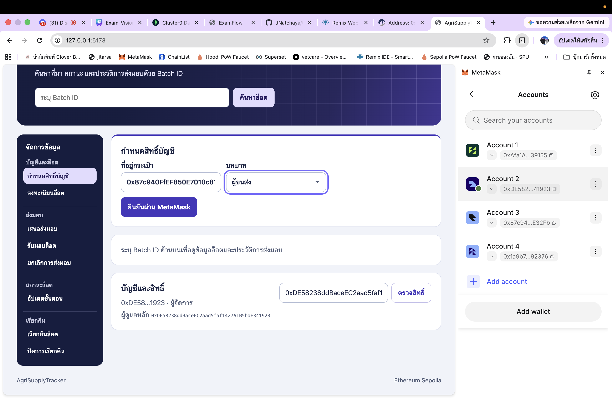

**ภาพที่ 02** เกษตรกร Account 1 กรอก Batch ID ชื่อสินค้า เวลาเก็บเกี่ยว แหล่งผลิต และใบรับรอง

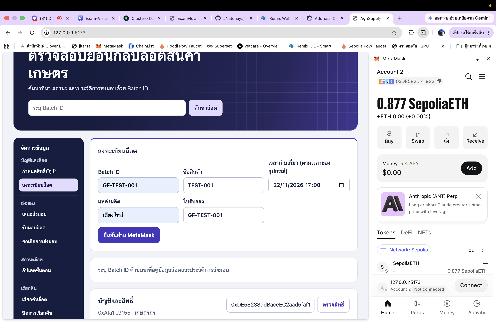

**ภาพที่ 03** ธุรกรรมลงทะเบียนยืนยันแล้ว ล็อตอยู่ในขั้นเก็บเกี่ยวและเกษตรกรเป็นผู้ครอบครองรายแรก

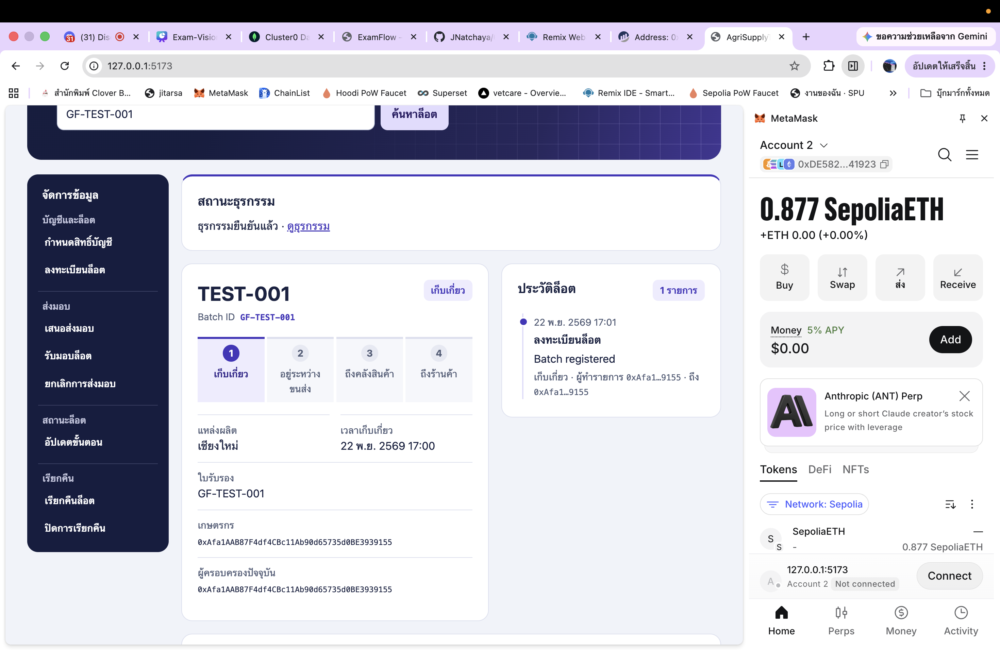

### ส่งมอบจากเกษตรกรไปยังผู้ขนส่ง

**ภาพที่ 04** เกษตรกรระบุที่อยู่ผู้ขนส่งในฟอร์มเสนอส่งมอบ

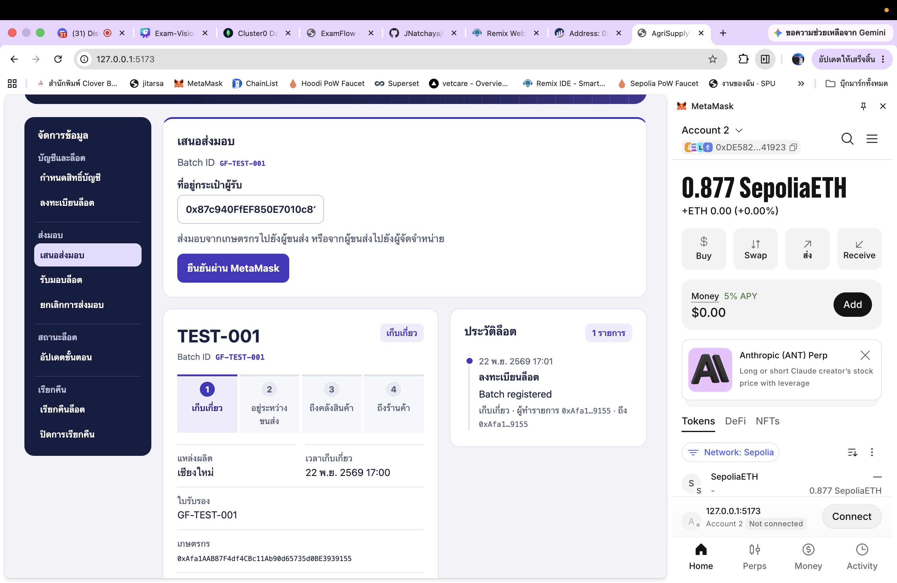

**ภาพที่ 05** ระบบแสดงผู้ขนส่งเป็นผู้รอรับมอบ โดยเกษตรกรยังเป็นผู้ครอบครอง

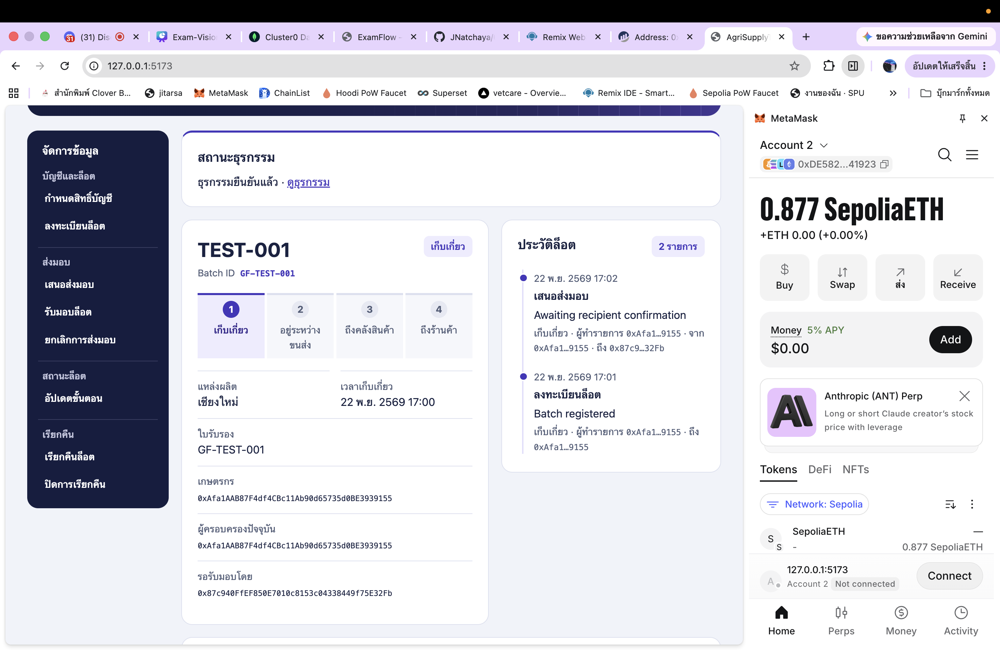

**ภาพที่ 06** เกษตรกรยกเลิกคำขอ รายการรอรับมอบหายไปและประวัติบันทึกการยกเลิก

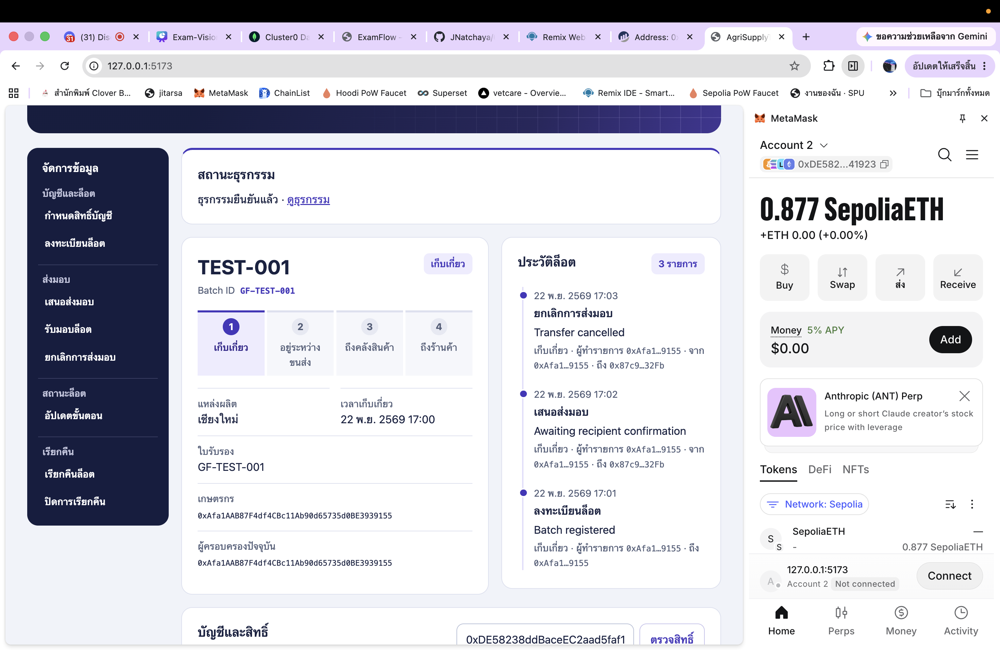

**ภาพที่ 07** เกษตรกรเสนอส่งมอบใหม่และระบบแสดงผู้ขนส่งเป็นผู้รอรับมอบอีกครั้ง

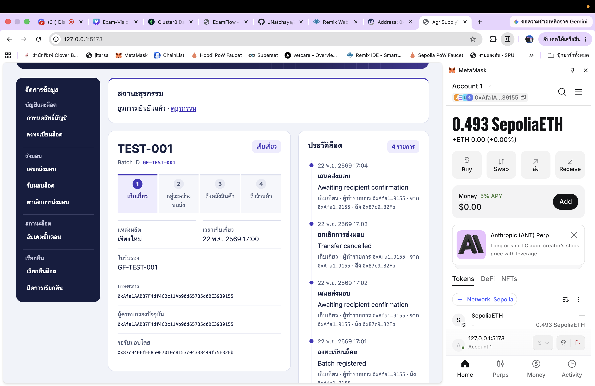

**ภาพที่ 08** ผู้ขนส่ง Account 3 เปิดคำขอยืนยันการรับมอบใน MetaMask บน Sepolia

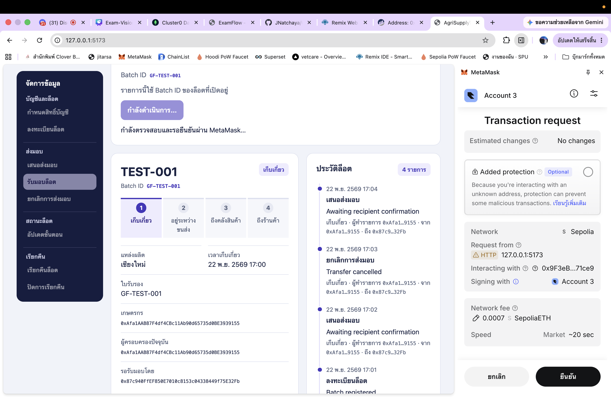

**ภาพที่ 09** ธุรกรรมรับมอบยืนยันแล้ว ประวัติแสดงการโอนการครอบครองจากเกษตรกรไปยังผู้ขนส่ง

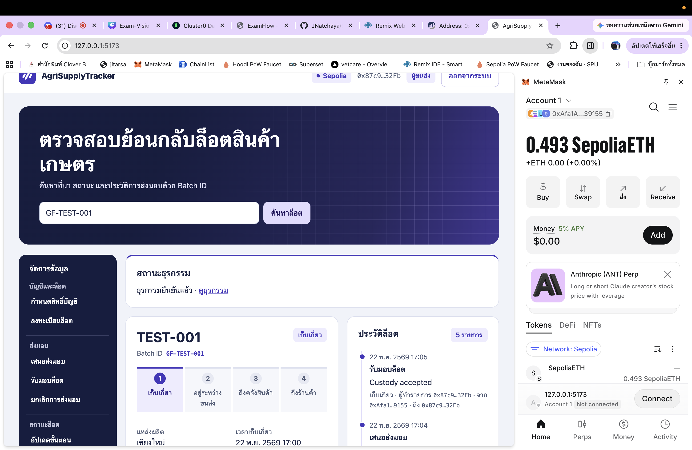

### อัปเดตสถานะและเสนอส่งมอบให้ผู้จัดจำหน่าย

**ภาพที่ 10** ผู้ขนส่งอัปเดตสถานะเป็นอยู่ระหว่างขนส่ง

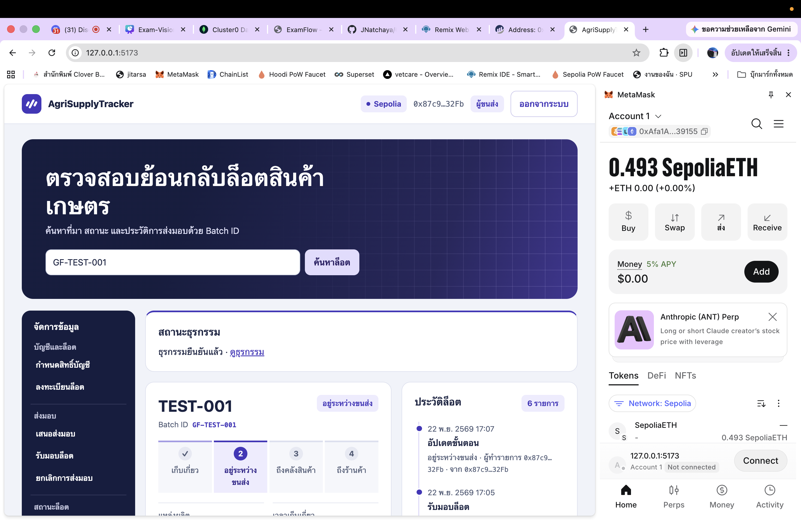

**ภาพที่ 11** ผู้ขนส่งอัปเดตขั้นถัดไปเป็นถึงคลังสินค้า

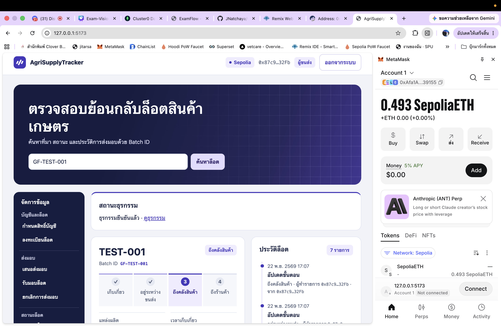

**ภาพที่ 12** ผู้ขนส่งเสนอส่งมอบให้ผู้จัดจำหน่ายขณะที่ล็อตอยู่ในขั้นถึงคลังสินค้า

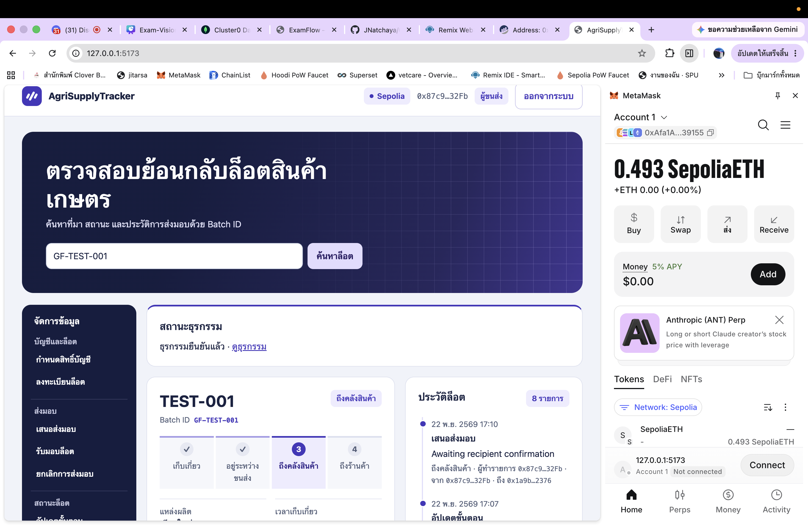

### เรียกคืนและปิดการเรียกคืน

**ภาพที่ 13** ผู้จัดการเรียกคืนด้วยเหตุผล “กล่องเสียหาย” เว็บขึ้นป้ายอยู่ระหว่างเรียกคืน และประวัติเพิ่มจาก 8 เป็น 10 รายการจากการยกเลิกคำขอที่ค้างและการเปิดเรียกคืน

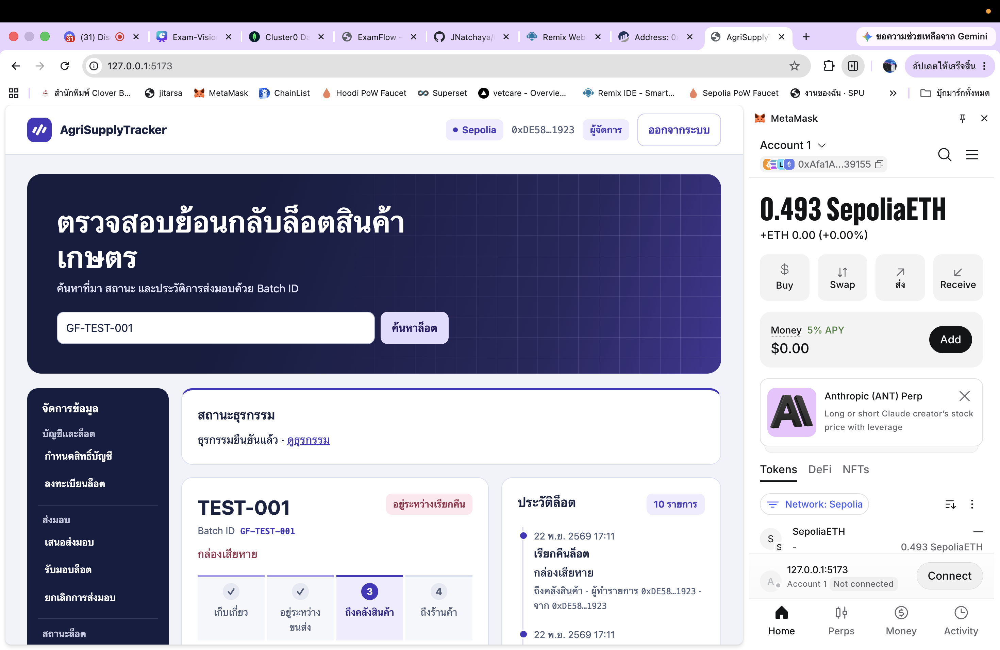

**ภาพที่ 14** ผู้จัดการปิดการเรียกคืนด้วยผลการดำเนินการ “เปลี่ยนกล่อง” ล็อตยังอยู่ในขั้นถึงคลังสินค้า

### ส่งมอบให้ผู้จัดจำหน่ายและอัปเดตว่าถึงร้านค้า

**ภาพที่ 15** ผู้ขนส่งเสนอส่งมอบให้ผู้จัดจำหน่ายอีกครั้งหลังปิดการเรียกคืน

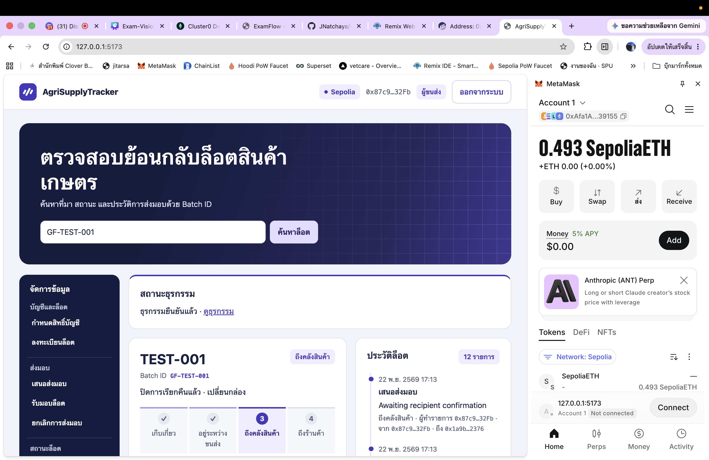

**ภาพที่ 16** ผู้จัดจำหน่าย Account 4 ยืนยันรับมอบ ประวัติเพิ่มเป็น 13 รายการ

**ภาพที่ 17** รายละเอียดล็อตแสดงผู้จัดจำหน่ายเป็นผู้ครอบครองปัจจุบัน

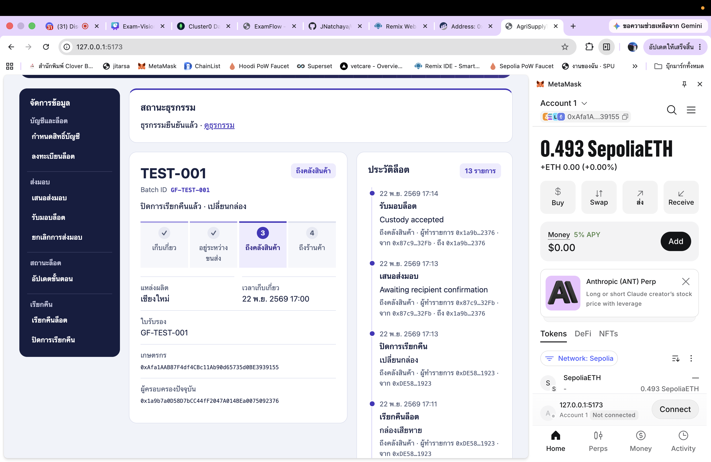

**ภาพที่ 18** ผู้จัดจำหน่ายอัปเดตเป็นถึงร้านค้า ประวัติล็อตแสดงทั้งหมด 14 รายการ

